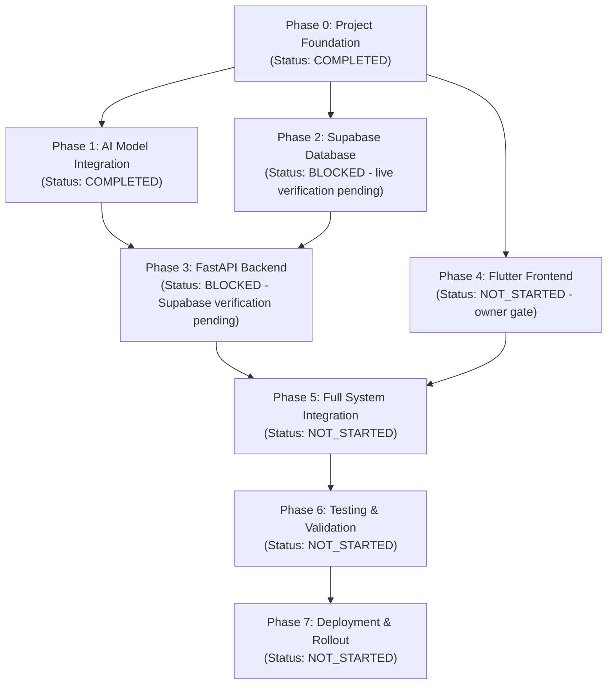

# NETRAVA — Master Implementation Plan

**Project:** NETRAVA — Explainable AI-Based Diabetic Retinopathy Screening System  
**Document Version:** 1.0.0  
**Status Standard:** `NOT_STARTED` | `IN_PROGRESS` | `BLOCKED` | `IN_REVIEW` | `COMPLETED`  
**Master Coordinator:** Agent 00 (Project Coordinator)

---

## 1. Overview and Execution Principles

This document governs the phased execution of the NETRAVA project across 8 progressive milestones (Phase 0 through Phase 7). Every task is bound to an assigned AI Agent, defined input prerequisites, expected output deliverables, strict completion criteria, and testing verifications.

No agent may advance to a downstream phase until all blocking dependencies from earlier phases have reached `COMPLETED` status with verifiable evidence.

**Owner gate:** Continue backend-only work until Phases 1-3 are verified. Do not start Flutter application development until the owner reviews backend completion and approves the frontend phase. The existing welcome/login prototype is preserved and is not frontend integration.

---

## Phase 0 — Project Foundation

- **Objective:** Establish the complete project structure, perform initial code and asset audit, establish multi-agent roles and guidelines, formalize design tokens, and create master tracking systems.
- **Assigned Agent:** Agent 00 (Project Coordinator) & Agent 07 (Documentation Engineer)
- **Current Status:** `COMPLETED`

### Tasks Breakdown
1. [x] **Task 0.1 — Repository & Asset Audit:** Inspect all existing Flutter code, training notebooks, architecture diagrams, datasets, and design zips. Document findings in `docs/PROJECT_AUDIT.md`.
2. [x] **Task 0.2 — Directory Scaffolding:** Create structured directory hierarchy (`frontend/`, `backend/`, `supabase/`, `ai_model/`, `docs/`, `design_reference/`, `shared/`, `scripts/`) preserving existing code.
3. [x] **Task 0.3 — Master Project Documentation:** Produce root `README.md` covering all 29 required operational and architectural dimensions.
4. [x] **Task 0.4 — Master Implementation Roadmap:** Create `IMPLEMENTATION_PLAN.md` with explicit phase gates.
5. [x] **Task 0.5 — Master Agent Instructions:** Create root `AGENT.md` setting operating protocols, file ownership, and handover rules.
6. [x] **Task 0.6 — Agent Role Definitions:** Author individual agent guidebooks (`AGENT_00` to `AGENT_07`) in `docs/agents/`.
7. [x] **Task 0.7 — Work History Ledger:** Initialize `docs/agents/WORK_LOG.md` with Task Entry 001.
8. [x] **Task 0.8 — Design System Documentation:** Extract design tokens, color palette, typography, spacing, and 14 screen specifications from `stitch_netrava_retinal_screening_app.zip` into `design_reference/`.
9. [x] **Task 0.9 — Architecture & Contract Blueprints:** Author `SYSTEM_ARCHITECTURE.md`, `DATABASE_ARCHITECTURE.md`, `API_DOCUMENTATION.md`, `SECURITY.md`, and OpenAPI specifications.
10. [x] **Task 0.10 — Foundation Sign-off:** Lead coordinator review and validation of all Phase 0 artifacts before feature coding commences.

- **Required Inputs:** Existing codebase at `C:\Users\HP\NETRAVA`, Jupyter notebook at `C:\Users\HP\NETRAVA_B3_Improved_Training (1).ipynb`, design archive `stitch_netrava_retinal_screening_app.zip`.
- **Expected Outputs:** Fully established project directory, 100% comprehensive documentation, clean separation of concerns, and agent onboarding manuals.
- **Dependencies:** None.
- **Completion Criteria:** All Phase 0 documentation files committed, verified for internal consistency, and approved without orphaned references.
- **Testing Requirements:** Verify markdown links, validate folder existence, and ensure no files were overwritten or destroyed.

---

## Phase 1 — AI Model Integration

- **Objective:** Reconstruct the EfficientNet-B3 network, verify image preprocessing and normalization, load the trained staged checkpoint, execute local test inference, and validate Grad-CAM heatmap generation.
- **Assigned Agent:** Agent 04 (AI/ML Integration Engineer)
- **Current Status:** `COMPLETED`

### Tasks Breakdown
1. [x] **Task 1.1 — Checkpoint Retrieval & Verification:** Locate and verify `best_efficientnet_b3_staged.pth` file integrity, confirming state dict keys, model name (`efficientnet_b3`), and output class count (5). (Verified: 574 tensor keys, epoch 20, best_val_qwk 0.8716).
2. [x] **Task 1.2 — Architecture Rebuilder:** Write `ai_model/inference/model_loader.py` to instantiate `timm.create_model('efficientnet_b3', pretrained=False, num_classes=5, drop_rate=0.30)` and load weights safely with strict state_dict matching.
3. [x] **Task 1.3 — Aspect-Ratio Preprocessing Module:** Implement `ai_model/inference/preprocessing.py` replicating `ResizeWithPadding(size=300, fill=(0,0,0))` using LANCZOS interpolation and ImageNet normalization ($\mu=[0.485, 0.456, 0.406]$, $\sigma=[0.229, 0.224, 0.225]$).
4. [x] **Task 1.4 — Inference & Probability Service:** Implement `ai_model/inference/predictor.py` computing Softmax probabilities, top-1 predicted DR grade, confidence scores, and ICDR severity classification.
5. [x] **Task 1.5 — Grad-CAM Heatmap Generator:** Implement `ai_model/inference/gradcam.py` hooking into `model.conv_head` to extract activations and gradients, computing rectified weighted heatmaps, alpha-blending with original scans, and safely cleaning up hooks.
6. [x] **Task 1.6 — Standalone Validation Suite:** Execute 20 automated tests in `ai_model/tests/` verifying model loading, preprocessing, 5-class output, and Grad-CAM generation (20/20 passed in 14.38s).

- **Required Inputs:** `best_efficientnet_b3_staged.pth`, reference training notebook, sample APTOS fundus images.
- **Expected Outputs:** Reusable, thread-safe Python ML module capable of accepting raw image bytes and returning structured predictions with heatmap overlays.
- **Dependencies:** Phase 0 completion; model checkpoint downloaded locally.
- **Completion Criteria:** ML inference script successfully classifies a test image and generates a valid Grad-CAM JPEG/PNG artifact with verified non-zero gradients.
- **Testing Requirements:** Unit test checking input tensor shapes ($1 \times 3 \times 300 \times 300$), probability sum ($\approx 1.0$), and heatmap dimension ($300 \times 300$).

---

## Phase 2 — Supabase Database & Cloud Infrastructure

- **Objective:** Provision the Supabase cloud PostgreSQL database, implement the 10-table relational schema with indexes, configure Row Level Security (RLS) policies for each role, establish private storage buckets, and test connectivity.
- **Assigned Agent:** Agent 05 (Database Engineer)
- **Current Status:** `BLOCKED` (local migration and policies authored; no Supabase project/CLI/PostgreSQL client is configured for execution or connectivity verification)

### Tasks Breakdown
1. [x] **Task 2.1 — Schema DDL Definition:** Authored `supabase/migrations/202611030001_backend_core.sql` for clinics, profiles, patients, screenings, images, predictions, reports, and audit logs.
2. [x] **Task 2.2 — Foreign Keys & Constraints:** Added clinic-scoped relationships, unique clinic/MRN constraint, and grade/data checks.
3. [x] **Task 2.3 — Row Level Security (RLS) Policies:** Added local policies for clinic-bound access and append-only audit records; PostgreSQL execution remains unverified.
4. [x] **Task 2.4 — Storage Buckets Configuration:** Declared private fundus, Grad-CAM, and report buckets and clinic-folder policies; Supabase behavior remains unverified.
5. [ ] **Task 2.5 — Seed Data Scripting:** Author `supabase/seed/001_seed_users_and_patients.sql` with mock technicians, clinicians, and sample longitudinal patient records for local development.
6. [ ] **Task 2.6 — Connectivity Verification:** Test database connections, transaction isolation, and bucket upload/download via Supabase Python SDK.

- **Required Inputs:** Database architecture specifications from `docs/DATABASE_ARCHITECTURE.md`.
- **Expected Outputs:** Executable, idempotent SQL migration files ready for `supabase db push` and verified database schema.
- **Dependencies:** Phase 0 completion.
- **Completion Criteria:** All tables, indexes, triggers, and RLS policies successfully applied without errors; test user can query only permitted records.
- **Testing Requirements:** Automated SQL test suite executing positive and negative access attempts across different user roles.

---

## Phase 3 — FastAPI Backend Development

- **Objective:** Develop the production REST API microservice encapsulating business logic, image upload pipelines, automated quality control (QC), AI inference orchestration, report compilation, and error handling.
- **Assigned Agent:** Agent 03 (Backend Engineer)
- **Current Status:** `BLOCKED` (local server, model-backed API, and automated tests verified; live database/storage operations and remaining production checks require a configured development Supabase project)

### Tasks Breakdown
1. [x] **Task 3.1 — Server Scaffold & Configuration:** FastAPI app, CORS, logging, exception handlers, production secret checks, and repository-root model path resolution are implemented and locally verified.
2. [x] **Task 3.2 — Auth & Authorization:** Supabase token introspection and database-backed role/clinic lookup are implemented; only test-mode tokens were exercised locally because no Supabase project is configured.
3. [x] **Task 3.3 — Patient Management APIs:** Patient create/list implementation is clinic-scoped and writes through a transaction/audit RPC; live persistence is unverified.
4. [x] **Task 3.4 — Screening & Image Upload API:** Magic-byte, size, decode, QC, storage, clinic checks, and fail-closed persistence are implemented; live storage is unverified.
5. [x] **Task 3.5 — Image Quality Control (QC) Service:** Laplacian blur and illumination checks are implemented and locally tested.
6. [x] **Task 3.6 — AI Prediction & Grad-CAM Endpoint:** Multipart prediction was tested with the real checkpoint; clinic-scoped persistence and heatmap storage use RPC/service operations not yet run live.
7. [x] **Task 3.7 — Clinical Reporting API:** Clinic-scoped report read and ophthalmologist review endpoints are implemented; the review RPC appends audit events transactionally.
8. [x] **Task 3.8 — Health & System Diagnostics:** Health reports model state and probes Supabase read-only; GPU/CPU utilization metrics are not implemented.

- **Required Inputs:** ML module from Phase 1, Supabase schema from Phase 2, OpenAPI contracts from Phase 0.
- **Expected Outputs:** Fully functioning FastAPI backend passing all route tests and generating real-time predictions and heatmaps.
- **Dependencies:** Phase 1 (Model loader & Grad-CAM) and Phase 2 (Supabase schema).
- **Completion Criteria:** All endpoints operational, OpenAPI documentation generated at `/docs`, and end-to-end inference tested via API client.
- **Testing Requirements:** Pytest test suite covering route responses, validation errors, role authorization rejections, and mocked model inference.

---

## Phase 4 — Flutter Mobile Frontend Development

- **Objective:** Implement the complete Flutter mobile client based on the 14 reference screens and *Clinical Precision AI* design system, including camera capture, image QC, AI visualization, patient registry, and reporting.
- **Assigned Agent:** Agent 01 (Frontend Architect) & Agent 02 (UI/UX Designer)
- **Current Status:** `IN_PROGRESS` — owner explicitly requested implementation on 2026-11-14. Android builds, analyzer and automated frontend workflows pass. Live authenticated acceptance remains pending. The new owner request supersedes the earlier frontend pause; it does not assert that historical hosted-backend gates were completed.

### Current implementation against actual backend (2026-11-14)

- [x] Central API configuration, green theme/local Poppins, feature-based architecture.
- [x] Dio bearer/error handling, secure session restore, server-assigned role routing and logout.
- [x] Real email login; unsupported OAuth and role-selection screens omitted.
- [x] Dashboard, searchable/paginated patients, exact intake form and patient details.
- [x] OD/OS, native gallery/camera picker, upload, actual server QC and recapture.
- [x] Exact-byte prediction request, loading, grade/confidence/probabilities and actual Grad-CAM.
- [x] Screening-ID report lookup, clinician/admin draft/review, immutable sign-off and PDF open.
- [x] Android debug APK build, clean static analysis, nine unit/widget tests and Pixel 10 real-backend health/startup test.
- [ ] Owner sign-in and complete live patient/upload/inference/review/PDF acceptance.

The historical task list below is retained as the original design roadmap. Several
items (OAuth, selectable roles, screening queues/history and referral dispatch)
are outside the existing backend contract and are not represented as working
features. See `frontend/flutter_app/FRONTEND_GUIDE.md` for the implemented scope.

### Tasks Breakdown
1. [ ] **Task 4.1 — Design System & Theme Engine:** Implement theme extensions in `lib/core/theme/` embodying `design_reference/design_system/` tokens (Inter typography, primary `#08785F`, surface `#E5FFF7`, pill badges).
2. [ ] **Task 4.2 — Networking & State Management:** Setup Dio HTTP client with interceptors for token attachment and retry logic; configure Riverpod/Provider state management architecture.
3. [ ] **Task 4.3 — Authentication Screens:** Enhance `LoginScreen` and implement `02_get_started_sign_in_options`, Google OAuth, and Microsoft SSO placeholder hooks.
4. [ ] **Task 4.4 — Role Selection & Routing:** Implement `06_select_your_role` directing users to their designated role shell (Technician vs. Clinician).
5. [ ] **Task 4.5 — Technician Dashboard:** Implement `07_technician_dashboard` featuring screening queue counters, quick action cards, and recent patient activity list.
6. [ ] **Task 4.6 — Patient Registration & Medical History:** Implement `08_patient_registration_intake_form` and `09_patient_profile_medical_history` supporting demographic intake and HbA1c tracking.
7. [ ] **Task 4.7 — Camera Capture & Optical Alignment:** Implement `10_fundus_camera_live_capture_optical_alignment` with circular fundus reticle, eye toggle (OD/OS), and flash/focus controls.
8. [ ] **Task 4.8 — Image Quality Assessment Screen:** Implement `11_real_time_image_quality_qc_assessment` showing sharpness metrics and retake recommendations.
9. [ ] **Task 4.9 — AI Analysis & Heatmap Screen:** Implement `12_ai_diagnostic_inference_lesion_heatmap` with dual-view toggle, zoom/pan inspection, and Grad-CAM opacity slider.
10. [ ] **Task 4.10 — Clinical Report & Referral Dispatch:** Implement `13_clinical_report_grading_summary` and `14_export_sync_tele_ophthalmology_referral` for report generation and specialist escalation.

- **Required Inputs:** Design reference screens in `design_reference/screenshots/`, design tokens from `design_reference/design_system/`, and API contracts.
- **Expected Outputs:** Fully compiled, responsive Flutter client executable on Android and iOS devices.
- **Dependencies:** Phase 0 design tokens; backend API contracts.
- **Completion Criteria:** All 14 screens implemented with pixel-level fidelity to design references, free of overflow errors, and connected to mock/live data providers.
- **Testing Requirements:** Flutter widget tests for core components and golden tests for critical visual widgets.

---

## Phase 5 — Full System Integration

- **Objective:** Bridge the Flutter frontend, FastAPI backend, PyTorch AI engine, and Supabase cloud infrastructure into a seamless, end-to-end operational pipeline.
- **Assigned Agent:** Agent 00 (Lead Coordinator) supported by all agents
- **Current Status:** `NOT_STARTED`

### Tasks Breakdown
1. [ ] **Task 5.1 — Client-Server API Binding:** Switch Flutter API client from mock repositories to live FastAPI endpoints.
2. [ ] **Task 5.2 — Real-Time Image Upload & Inference Pipeline:** Test end-to-end flow from mobile camera capture -> backend QC -> PyTorch prediction -> Grad-CAM rendering -> Supabase storage -> mobile display.
3. [ ] **Task 5.3 — Signed URL Media Streaming:** Verify secure delivery of raw fundus photos and Grad-CAM overlays to Flutter client via temporary signed URLs.
4. [ ] **Task 5.4 — Longitudinal Data Synchronization:** Test multi-visit screening records and verify patient history timeline rendering.
5. [ ] **Task 5.5 — Ophthalmologist Review Loop:** Test clinician grade override and verify audit log generation in PostgreSQL.

- **Required Inputs:** Working deliverables from Phases 1, 2, 3, and 4.
- **Expected Outputs:** Fully integrated NETRAVA platform functioning without mocked dependencies.
- **Dependencies:** Phases 1 through 4 completed.
- **Completion Criteria:** Complete patient screening cycle executed on live mobile client in under 5 seconds with valid diagnosis and visible Grad-CAM heatmap.
- **Testing Requirements:** End-to-end integration test executing full screening lifecycle from intake to referral.

---

## Phase 6 — Testing, Quality Assurance & Security Validation

- **Objective:** Conduct rigorous system-wide testing across functional correctness, diagnostic accuracy, security posture, API performance, and medical compliance.
- **Assigned Agent:** Agent 06 (QA Engineer)
- **Current Status:** `NOT_STARTED`

### Tasks Breakdown
1. [ ] **Task 6.1 — Unit & Integration Test Suite:** Achieve >80% test coverage across backend business logic and Flutter presentation models.
2. [ ] **Task 6.2 — Model Inference Verification:** Run automated test batch against 100 validation images, verifying QWK score consistency with research notebook.
3. [ ] **Task 6.3 — Security & Penetration Audit:** Test JWT tampering, SQL injection resilience, RLS bypass attempts, and verify zero public S3 bucket leakage.
4. [ ] **Task 6.4 — Network Resilience & Offline Sync:** Verify mobile app behavior under unstable networks, airplane mode, and automated reconnection queueing.
5. [ ] **Task 6.5 — Medical Safety & Disclaimer Audit:** Ensure clinical disclaimers are present on all screens, exported PDFs, and API payloads.

- **Required Inputs:** Integrated system from Phase 5.
- **Expected Outputs:** QA test reports, security audit sign-off, bug tracking log, and performance benchmark documentation.
- **Dependencies:** Phase 5 completion.
- **Completion Criteria:** Zero critical or high-severity vulnerabilities; all test suites green.
- **Testing Requirements:** Load testing (50 concurrent inferences), security vulnerability scanning, and regression test suite.

---

## Phase 7 — Production Deployment & Release

- **Objective:** Package and containerize backend microservices, configure production cloud database and storage environments, generate release mobile builds, and finalize operational documentation.
- **Assigned Agent:** Agent 03 (Backend Engineer), Agent 01 (Frontend Architect), Agent 07 (Documentation Engineer)
- **Current Status:** `NOT_STARTED`

### Tasks Breakdown
1. [ ] **Task 7.1 — Containerization & Dockerfile:** Author multi-stage `Dockerfile` and `docker-compose.yml` for FastAPI backend with GPU/CPU support.
2. [ ] **Task 7.2 — Production Supabase Configuration:** Apply production migrations, verify database backups, and validate storage retention policies.
3. [ ] **Task 7.3 — Flutter Release Build:** Build signed Android APK/App Bundle and iOS release archive with obfuscation enabled.
4. [ ] **Task 7.4 — Health Monitoring & Alerting:** Configure Sentry / Prometheus metrics and structured logging for inference latency and error tracking.
5. [ ] **Task 7.5 — Handover & User Manuals:** Author field technician user guide, ophthalmologist review guide, and system administrator handbook.

- **Required Inputs:** Validated codebase from Phase 6.
- **Expected Outputs:** Production-ready container images, signed mobile release artifacts, and deployment runbooks.
- **Dependencies:** Phase 6 sign-off.
- **Completion Criteria:** Backend running healthy on target server; mobile application installed and successfully screening on real hardware.
- **Testing Requirements:** Smoke testing in production staging environment.

## Backend verification update ? 2026-11-13

Status: **BLOCKED / NOT READY FOR FRONTEND**. Project .venv (Python 3.11.9): **94 tests passed**, 6 warnings. Startup, model, health, Swagger, CORS and read-only Supabase connectivity verified. Live account credentials were not located. Four required transactional RPCs are absent from live REST metadata; unsafe direct-write fallbacks were removed. No live writes or migration changes performed. See [full verification report](docs/BACKEND_VERIFICATION_2026-11-13.md) for files, endpoint results, root causes and blockers. No route or request/response field changes; shared OpenAPI regenerated with installed dependencies. Flutter remains paused.

## Backend implementation continuation - 2026-11-13

- Agent: Codex, backend/database/QA/documentation roles authorized by owner.
- Local implementation completed: normalized transactional RPC migration, structured
  intake, complete report field roundtrip, authenticated PDF retrieval, restrictive
  clinic RLS/backend-only storage policies, image hash binding and safe SQL errors.
- Legacy conflicting migration preserved in supabase/legacy; only the normalized
  migration remains in the active sequence. No hosted schema/data/policies changed.
- Verification: 114 pytest passed (0 failed/skipped); 50 actual PostgreSQL checks;
  16 FastAPI workflow checks with actual SQL and real model. Combined coverage 85%.
  PDF rendered/visually checked; checkpoint hash unchanged; pip check passes.
- Status: local implementation DONE; hosted deployment/live acceptance BLOCKED on
  owner SQL Editor action and privately run account/Storage verification. Flutter
  remains paused. The service-role REST key cannot execute arbitrary SQL.
- Handover: docs/FINAL_BACKEND_READINESS_REPORT.md is authoritative; it contains all
  endpoint results, the exact migration and one operator-run verification procedure.
  scripts/verification/verify_live_backend.py prompts privately and prints no secrets.

## Retinal verification fixture correction - 2026-11-13

The owner reports live authentication and patient APIs pass; screening stopped at
422 IMAGE_UNGRADABLE (original default blur score 6.26). Reproduced that score locally.
Production QC/threshold and upload validation are unchanged. The live verifier now
uses a documented fixed 400px LANCZOS derivative of bundled retinal source
001639a390f0.png (400x266, blur 69.47, optimal illumination). The source is untouched;
no sharpening/noise or dynamic QC-tuned transforms are used. This is a test-fixture
resolution choice, not a clinical-quality calibration.

Preflight runs the real validator/QC before login or database writes. Custom files
are checked unchanged. Both uploads reuse identical encoded bytes. Added helper
scripts/verification/retinal_fixture.py and regression tests; see
scripts/verification/README.md for the exact private command and offline preflight.
The local actual-SQL/model workflow passed all 16 API and 50 PostgreSQL checks with
the same retinal fixture, including screening, Grad-CAM, report/PDF and isolation.
The owner will rerun the full live procedure privately; credentials are not available
to this agent. No additional hosted changes or live verification were performed in
this fixture correction. READY FOR FRONTEND remains pending full live exit-0 proof.

Fixture correction validation: **119 passed, 0 failed, 0 skipped** (6 dependency warnings), 16.59 seconds. Production screening_service.py and image_validator.py were not modified.

### 2026-11-14 ? Public signup
- [x] Backend signup, safe pending-profile migration, Flutter auth form and local backend/PostgreSQL tests.
- [ ] BLOCKED: reviewed hosted migration and real new-account/clinic-approval/full clinical workflow verification; owner approval required for hosted writes.
See docs/AUTH_SIGNUP_REPORT.md.

### 2026-11-14 ? Simplified active signup (supersedes approval flow)
- [x] Phone validation/storage, active technician and private workspace provisioning, Flutter login redirect, local API/SQL/RLS checks.
- [ ] BLOCKED for hosted acceptance: deploy reviewed active-signup migration, configure email confirmation for immediate login, and verify real new-email clinical workflow. See docs/AUTH_SIGNUP_REPORT.md.

### Signup password and Forgot Password
- [x] Chosen-password signup, explicit existing-email error, configurable recovery email/browser reset flow, backend and Flutter tests.
- [ ] BLOCKED for live acceptance: fresh owner-controlled email, Supabase recovery URL/template/SMTP configuration, genuine hosted signup and password-reset login verification.
See docs/PASSWORD_RECOVERY_REPORT.md.

### 2026-11-15 ? Current evidence-based status
See docs/CURRENT_PROJECT_STATUS.md (supersedes older summaries). 158 backend/AI tests and 11 Flutter tests pass. Core live auth works; full hosted clinical workflow/recovery pending. Critical design gate: new private technician cannot create a clinical report/PDF without an authorized reviewer in its workspace or a distinct preliminary AI PDF implementation. No code changes authorized by this audit.

### 2026-11-15 - Signup acceptance continuation
- [x] Diagnose phone connectivity: Tailscale reaches backend; existing login works.
- [x] Add safe provider-stage/error-category diagnostics and confirmation-specific login errors; 70 relevant backend tests pass.
- [ ] Identify exact hosted signup failure on the next user retry and repair its cause; confirm new-user signup/login live. No completion claim yet.

### 2026-11-15 - Hosted signup workspace-name fix
- [x] Identify exact hosted signup failure: SQLSTATE23505 on unique clinic_name.
- [x] Add/test full-UUID workspace-name forward migration; preserve isolation and existing data.
- [x] Apply to hosted Supabase; post-commit function verification returned true.
- [ ] Confirm a fresh signup and subsequent email-confirmed login through the phone.

### 2026-11-15 - Immediate signup configuration applied
- [x] Owner approval for hosted Confirm email OFF received.
- [x] Hosted setting saved; read-only verification confirms email signup enabled and mailer_autoconfirm=true.
- [x] Existing new profile's name/email/phone/active technician/workspace verified saved.
- [ ] Existing pending identity one-time confirmation needs explicit authorization after automatic approval review rejected the write.
- [ ] User-driven fresh signup and immediate login acceptance.

### 2026-11-15 - Existing account confirmation resolved
- [x] Confirm only the named existing new-user account after the owner's account-specific follow-up; verify provider confirmation state.
- [x] Reverify immediate public signup and active technician/private workspace persistence.
- [ ] Owner's phone login acceptance with private password.

### 2026-11-16 - Final Android readiness audit
- [x] Audit active Flutter/backend/AI/database/Auth/storage/PDF/Android code and record findings before changes.
- [x] Complete existing upload feedback with percentage/server-wait state and regression test.
- [x] Retest: 184 Python tests, 19 Flutter tests, clean Flutter analysis; 18 real-model/local-SQL API checks and 50 SQL checks; signup uniqueness/RLS regression.
- [x] Start actual backend, load checkpoint, verify localhost and PC Tailscale health, hosted read-only Auth/buckets/schema/anonymous denial, and missing/invalid-token denial (provider timeout on initial invalid-token attempt documented).
- [x] Build debug APK with physical-phone API_BASE_URL; inspect merged package/configuration and exact configured-secret absence.
- [x] Deliver docs/FINAL_ANDROID_READINESS_AUDIT.md with commands, changed files, actual evidence and scoped READY FOR PHYSICAL ANDROID TESTING recommendation.
- [ ] Owner-driven hosted synthetic signup/login-to-screening-to-AI-PDF acceptance and second-workspace isolation.
- [ ] Physical phone gallery/camera, PDF viewer/save, restart/logout, frame timing and low-memory acceptance.
- [ ] Real recovery delivery/reset acceptance; production signing/HTTPS and clinical QC/calibration remain outside this controlled testing sign-off.

### 2026-11-21 - Windows development launcher and ngrok
- [x] Audit the existing backend, ngrok agent, Flutter transport, and environment configuration.
- [x] Add start, stop, restart, and status with process ownership and local/public health checks.
- [x] Configure the verified ngrok domain for Android development and verify default and override in Flutter tests.
- [x] Validate healthy process reuse, external process protection, port collision reporting, and the public health endpoint.
- [ ] Validate a new managed ngrok session after the existing external tunnel is closed, and complete synthetic Android device acceptance.
