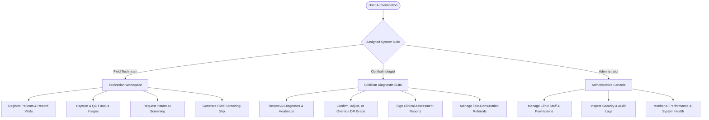
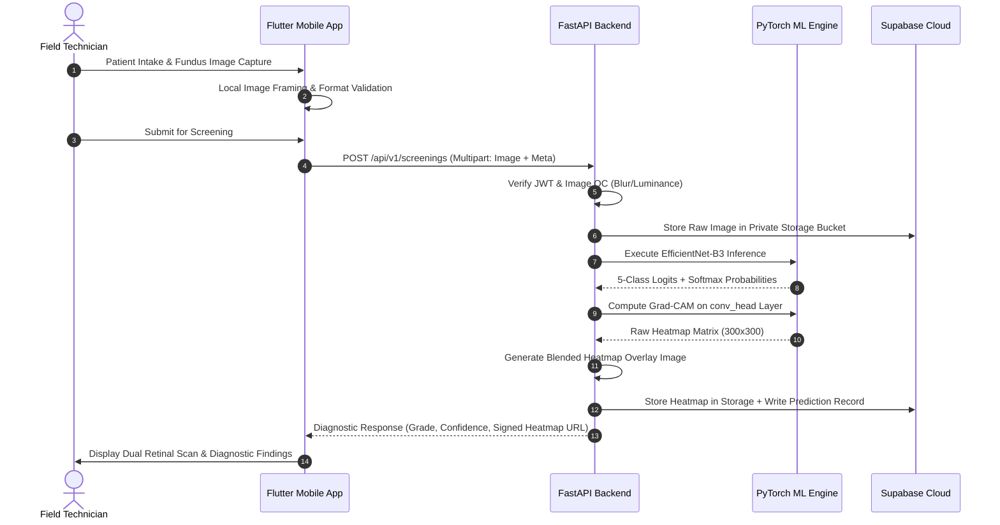
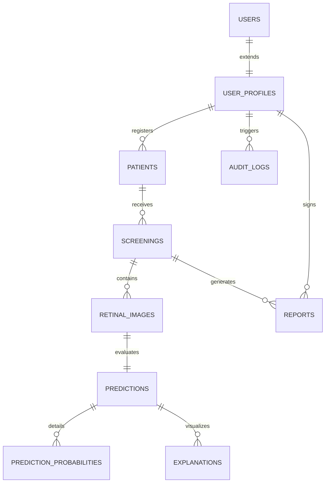

# NETRAVA — Explainable AI-Based Diabetic Retinopathy Screening System

<div align="center">

**See. Detect. Explain.**

[](https://flutter.dev)
[](https://python.org)
[](https://fastapi.tiangolo.com)
[](https://pytorch.org)
[](https://supabase.com)
[](#14-project-folder-structure)

</div>

---

## 1. Project Introduction

**NETRAVA** is an enterprise-grade medical imaging solution engineered to deliver point-of-care, AI-assisted screening for **Diabetic Retinopathy (DR)**. By marrying deep learning vision models with transparent Grad-CAM (Gradient-weighted Class Activation Mapping) explainability, NETRAVA equips healthcare professionals with interpretable diagnostic insights in under 3 seconds per eye.

The system is built as a cohesive client-server ecosystem:
- **Mobile Client:** A cross-platform Flutter application tailored for field health workers, clinic technicians, and consulting ophthalmologists.
- **Inference & Orchestration Server:** A high-throughput Python FastAPI microservice running PyTorch and OpenCV.
- **Cloud Infrastructure:** Supabase PostgreSQL with strict Row Level Security (RLS), GoTrue identity management, and encrypted S3-compatible medical imaging storage.

---

## 2. Project Objective

Diabetic Retinopathy is the leading cause of preventable blindness among working-age adults globally. NETRAVA aims to:
- Decentralize early-stage DR screening from tertiary hospitals into primary health centers and rural camps.
- Democratize access by integrating with lightweight portable fundus cameras and smartphones.
- Bridge the clinical trust deficit by complementing probabilistic severity predictions with spatial visual heatmaps highlighting microaneurysms, hemorrhages, and hard exudates.
- Streamline ophthalmologist triage through automated patient queueing, referral generation, and electronic medical record (EMR) synchronization.

---

## 3. Problem Statement

1. **Massive Diagnostic Shortage:** Millions of diabetic individuals reside in regions with acute shortages of certified ophthalmologists and retinal specialists.
2. **Asymptomatic Early Stages:** Diabetic Retinopathy develops silently without pain or subjective vision changes until irreversible retinal ischemia or macular edema occurs.
3. **The "Black Box" Barrier:** Traditional deep learning algorithms produce numerical probabilities without spatial justification, discouraging clinical adoption due to liability and verification concerns.
4. **Disjointed Field Workflows:** Existing clinical workflows lack integrated tools combining hardware camera capture, automated image quality control (QC), AI grading, longitudinal record keeping, and tele-referral dispatch in a single offline-resilient mobile app.

---

## 4. Proposed Solution

NETRAVA provides an integrated, end-to-end clinical workflow:
1. **Intelligent Capture & Real-Time QC:** Guides technicians through live fundus camera optical alignment and immediately validates clarity, illumination, and macular centering before inference.
2. **Fine-Tuned EfficientNet-B3 Vision Core:** Employs an optimized, staged-trained deep convolutional neural network processing $300 \times 300$ fundus images.
3. **Explainable AI (Grad-CAM):** Computes gradient-weighted activation maps from the network's final convolutional layer (`conv_head`), projecting a high-contrast heatmap over retinal lesions.
4. **Structured Clinical Reporting:** Formats predictions in compliance with the International Clinical Diabetic Retinopathy (ICDR) scale and provides downloadable, shareable clinical summaries.
5. **Secure Cloud Backplane:** Centralizes data storage under HIPAA-inspired privacy protections using Supabase PostgreSQL, cryptographic hash auditing, and signed media URLs.

---

## 5. Key Features

- **5-Class Retinopathy Staging:** Classifies scans into No DR (0), Mild (1), Moderate (2), Severe (3), and Proliferative DR (4).
- **Instant Grad-CAM Heatmaps:** Generates visual explanations revealing the anatomical regions responsible for the AI's grading decision.
- **Real-Time Quality Assessment:** Automated Laplacian blur detection and exposure analysis prevents low-quality images from receiving false-negative classifications.
- **Tri-Role Workflow Engine:** Distinct tailored interfaces for Field Technicians, Ophthalmologists, and Administrators.
- **Longitudinal Patient Records:** Tracks progressive retinal changes over sequential visits with historical visual comparisons.
- **Offline-First Synchronization:** Allows technicians in remote screening camps to register patients and capture images offline, automatically syncing when connectivity returns.
- **Tele-Ophthalmology Referral Dispatch:** Facilitates one-tap escalation of high-risk cases (Severe NPDR, PDR) to regional vitreoretinal specialists with pre-filled clinical summaries.

---

## 6. User Roles and Permissions



### Role Matrix

| Capability | Field Technician | Ophthalmologist | Administrator |
|---|---|---|---|
| Register New Patient | Yes | Yes | Yes |
| View Assigned Patients | Yes | Yes (All Clinic) | Yes (All Clinic) |
| Capture & Upload Fundus Scans | Yes | Yes | View Only |
| Trigger AI Inference | Yes | Yes | Test Scans Only |
| View Grad-CAM Heatmaps | Yes | Yes | Yes |
| Override / Validate Diagnosis | No | Yes (Final Clinical Authority) | No |
| Sign Off Official Medical Report| No | Yes | No |
| Create / Deactivate User Accounts | No | No | Yes |
| Access Raw Audit Logs | No | No | Yes |

---

## 7. Application Workflow



---

## 8. Frontend Architecture

The mobile application is crafted with **Flutter** following **Clean Architecture** and feature-driven modularization:

```
frontend/flutter_app/lib/
├── app/                  # Application bootstrap, global providers, routing
├── core/                 # Shared infrastructure, network client, theme tokens
│   ├── constants/        # Route names, API URLs, global string constants
│   ├── network/          # Dio HTTP client, interceptors, error translators
│   └── theme/            # AppColors, AppTextStyles, AppTheme (Clinical Precision)
├── shared/               # Reusable widgets (Custom buttons, loaders, cards)
└── features/             # Modular feature slices
    ├── authentication/   # Email, Google, Microsoft login flows
    ├── role_selection/   # Role picker gateway
    ├── dashboard/        # Technician queue & metrics
    ├── patients/         # Patient registry, intake, and history
    ├── image_capture/    # Camera viewfinder & optical reticle
    ├── image_quality/    # QC blur & illumination screen
    ├── ai_analysis/      # Heatmap viewer & inspection tools
    ├── results/          # Clinical grading cards & severity badges
    ├── reports/          # PDF export & referral dispatch
    └── profile/          # User profile, clinic settings, sync state
```

---

## 9. Backend Architecture

The backend is developed in **FastAPI** utilizing an asynchronous, decoupled service layer:

```
backend/app/
├── api/
│   ├── deps.py           # Dependency injection (Current user, DB session)
│   └── v1/
│       ├── auth.py       # Authentication exchange & profile validation
│       ├── patients.py   # Patient CRUD operations
│       ├── screenings.py # Screening sessions & image uploads
│       ├── predict.py    # AI inference and Grad-CAM generation
│       └── reports.py    # Clinical report compilation & PDF generation
├── core/
│   ├── config.py         # Pydantic BaseSettings, environment variables
│   ├── security.py       # JWT verification & password utilities
│   └── logging.py        # Structured JSON application logging
├── ml/
│   ├── model_loader.py   # Thread-safe EfficientNet-B3 model singleton
│   ├── preprocessing.py  # Aspect-ratio-preserving 300x300 transform
│   ├── prediction.py     # Probability computation & thresholding
│   ├── gradcam.py        # Forward/backward PyTorch hook heatmap generator
│   └── qc.py             # Laplacian blur & exposure assessment
├── models/               # SQLAlchemy ORM entity definitions
├── schemas/              # Pydantic V2 request & response schemas
├── services/             # Business logic orchestration
└── database/             # PostgreSQL connection engine & Supabase client
```

---

## 10. AI Model Architecture

The neural network is a staged fine-tuned **EfficientNet-B3** architecture:

```mermaid
graph LR
    Input["Input Image (300 x 300 x 3)"] --> Stem["Stem Conv3x3 (s=2)"]
    Stem --> Blocks["MBConv Blocks 1 to 7 (DropRate=0.30)"]
    Blocks --> ConvHead["conv_head (1x1 Conv) [GRAD-CAM HOOK]"]
    ConvHead --> Pool["AdaptiveAvgPool2d (1x1)"]
    Pool --> Flatten["Flatten"]
    Flatten --> Dropout["Dropout (p=0.30)"]
    Dropout --> FC["Linear Classifier (1536 -> 5)"]
    FC --> Softmax["Softmax Activation"]
    Softmax --> Out["5 Severity Probabilities"]
```



### Staged Training Highlights
- **Backbone:** Pretrained weights from ImageNet-1k via `timm`.
- **Stage 1 (Warmup):** Backbone frozen; top classifier trained for 3 epochs to align linear weights with retinal distribution.
- **Stage 2 (Fine-Tuning):** Full network unfrozen with discriminative learning rates ($10^{-5}$ for backbone, $10^{-4}$ for classifier).
- **Class Balancing:** Square-root inverse frequency loss weighting to prevent bias toward Grade 0 (No DR).
- **Checkpoint Identification:** `best_efficientnet_b3_staged.pth` selected based on the highest validation Quadratic Weighted Kappa (QWK).

---

## 11. Supabase Database Architecture

The data layer is hosted on **Supabase PostgreSQL** utilizing 10 structured relational tables:



1. **`users` / `user_profiles`:** Auth ID mapping, roles (`technician`, `ophthalmologist`, `admin`), clinic affiliations.
2. **`patients`:** National ID / MRN, demographic data, diabetes duration, latest HbA1c, contact details.
3. **`screenings`:** Screening session metadata, visit date, status (`pending`, `completed`, `reviewed`).
4. **`retinal_images`:** Image file paths, eye designation (`OD` - Right / `OS` - Left), capture timestamp, QC score.
5. **`predictions`:** Predicted grade (0–4), ICDR severity label, model version, raw logits.
6. **`prediction_probabilities`:** Breakdown of probability values across all 5 classes.
7. **`explanations`:** Storage path to Grad-CAM heatmap overlay, target layer name, peak activation coordinates.
8. **`reports`:** Official diagnostic report, ophthalmologist review notes, signature status, PDF export URL.
9. **`audit_logs`:** Tamper-evident log of all clinical assessments, grade overrides, and data access.

---

## 12. Storage Architecture

Medical images are hosted in private Supabase Storage buckets configured with Row Level Security:
- **`fundus-images` (Private):** Stores raw retinal fundus captures in JPEG/PNG formats. Maximum upload size: 15 MB.
- **`gradcam-heatmaps` (Private):** Stores generated Grad-CAM RGB blended heatmaps.
- **`clinical-reports` (Private):** Stores generated PDF diagnostic reports.

*Access Control:* Client devices never receive direct public URLs to medical imagery. The backend generates cryptographically signed, time-limited URLs (default expiration: 30 minutes) upon authorized request.

---

## 13. Technology Stack

| Domain | Technology / Library | Purpose |
|---|---|---|
| **Frontend Framework** | Flutter 3.x / Dart | Cross-platform mobile development (iOS/Android) |
| **Frontend Styling** | Material 3 + Custom Painters | Clinical Precision AI design system |
| **Backend Framework** | FastAPI (Python 3.11+) | Asynchronous RESTful API engine |
| **Deep Learning** | PyTorch 2.2+, timm 0.9+ | EfficientNet-B3 model execution & Grad-CAM |
| **Image Processing** | Pillow, OpenCV, NumPy | Retinal image preprocessing and heatmapping |
| **Database & Auth** | Supabase (PostgreSQL 15+) | Cloud DB, RLS, user authentication |
| **Cloud Storage** | Supabase Storage (S3 API) | Encrypted storage for fundus images and reports |
| **PDF Generation** | ReportLab / WeasyPrint | Automated clinical report document rendering |
| **Deployment** | Docker & Uvicorn | Containerized production deployment |

---

## 14. Project Folder Structure

```
NETRAVA/
├── README.md                          # Master project documentation
├── AGENT.md                           # Master instructions for AI coding agents
├── IMPLEMENTATION_PLAN.md             # Multi-phase master implementation roadmap
├── .gitignore                         # Comprehensive Git ignore rules
├── .env.example                       # Root environment variable template
│
├── docs/                              # Project documentation suite
│   ├── PROJECT_AUDIT.md               # Verified audit of project assets
│   ├── PROJECT_OVERVIEW.md            # Clinical and technical project overview
│   ├── SYSTEM_ARCHITECTURE.md         # End-to-end distributed system architecture
│   ├── DATABASE_ARCHITECTURE.md       # Relational schema, DDL, and RLS policies
│   ├── API_DOCUMENTATION.md           # REST API specification and contracts
│   ├── SECURITY.md                    # Medical data privacy, HIPAA, and security
│   ├── DEPLOYMENT.md                  # Containerization, cloud host, and CI/CD
│   ├── agents/                        # Multi-agent coordination directory
│   │   ├── AGENT_00_COORDINATOR.md    # Lead Coordinator instructions
│   │   ├── AGENT_01_FRONTEND.md       # Flutter Architect instructions
│   │   ├── AGENT_02_UI_UX.md          # UI/UX Design System specialist instructions
│   │   ├── AGENT_03_BACKEND.md        # FastAPI Backend Engineer instructions
│   │   ├── AGENT_04_AI_ML.md          # PyTorch / Grad-CAM Engineer instructions
│   │   ├── AGENT_05_DATABASE.md       # Supabase Database Engineer instructions
│   │   ├── AGENT_06_QA.md             # Testing & QA Engineer instructions
│   │   ├── AGENT_07_DOCUMENTATION.md  # Technical Writer & Docs instructions
│   │   └── WORK_LOG.md                # Shared multi-agent immutable work history
│   ├── architecture/                  # Deep-dive architecture guides
│   │   ├── backend_architecture.md    # FastAPI service layers & patterns
│   │   ├── frontend_architecture.md   # Flutter state management & navigation
│   │   ├── database_architecture.md   # Detailed entity relationships & indexing
│   │   └── diagrams/                  # Visual architecture infographics
│   └── references/                    # Medical grading guides & external papers
│
├── design_reference/                  # Single source of truth for UI/UX
│   ├── README.md                      # Design system catalog and screen map
│   ├── design_system/                 # Design token documentation
│   │   ├── COLORS.md                  # Clinical Precision color tokens & HEX codes
│   │   ├── TYPOGRAPHY.md              # Inter typography scale & metrics
│   │   ├── SPACING.md                 # 4-column layout, padding & margins
│   │   ├── ICONS.md                   # Clinical icon guidelines
│   │   ├── COMPONENTS.md              # Atomic design component catalog
│   │   └── UI_GUIDELINES.md           # Handheld clinical ergonomics guidelines
│   ├── branding/                      # Logos, icons, vector painters
│   └── screenshots/                   # 14 Reference screens with code & mockups
│
├── frontend/                          # Client applications
│   └── flutter_app/                   # Cross-platform Flutter mobile client
│
├── backend/                           # Server application
│   ├── app/                           # FastAPI application package
│   ├── model/                         # Production model checkpoint directory
│   ├── tests/                         # Backend test suite (pytest)
│   ├── requirements.txt               # Python package dependencies
│   └── README.md                      # Backend operations guide
│
├── supabase/                          # Database infrastructure as code
│   ├── migrations/                    # Versioned PostgreSQL DDL migrations
│   ├── seed/                          # Seed data for testing and local dev
│   └── README.md                      # Supabase deployment instructions
│
├── ai_model/                          # Machine learning research and weights
│   ├── checkpoint/                    # Model weight artifacts (.pth)
│   ├── evaluation/                    # QWK, ROC-AUC, confusion matrices
│   └── reference/                     # Training notebooks and Colab scripts
│
├── shared/                            # Cross-system shared contracts
│   ├── api_contracts/                 # OpenAPI JSON/YAML specifications
│   ├── constants/                     # Shared class labels, error codes
│   └── documentation/                 # Sequence diagrams and data flows
│
└── scripts/                           # Automation scripts
    ├── setup/                         # Local development bootstrap scripts
    ├── development/                   # Linting, formatting, and mock runners
    └── deployment/                    # Container build and push scripts
```

---

## 15. Development Phases

- **Phase 0 — Project Foundation (Current Phase):** Complete project audit, master documentation, multi-agent instructions, design tokens, and folder architecture.
- **Phase 1 — AI Model Integration:** Load EfficientNet-B3 checkpoint, verify $300\times300$ preprocessing, validate 5-class logits, and calibrate Grad-CAM hooks.
- **Phase 2 — Supabase Database & Auth:** Execute SQL migrations, configure RLS policies, setup GoTrue auth roles, and initialize private storage buckets.
- **Phase 3 — FastAPI Backend Implementation:** Implement auth, patient CRUD, file upload, image QC, inference pipeline, and report compilation endpoints.
- **Phase 4 — Flutter Mobile Implementation:** Implement the 14 reference screens, camera capture viewfinder, state management, and API repository.
- **Phase 5 — Full System Integration:** Connect Flutter frontend to FastAPI, link FastAPI to Supabase, and test end-to-end diagnostic flow.
- **Phase 6 — Testing & Clinical Validation:** Execute unit tests, integration tests, RLS security tests, and inference benchmark suites.
- **Phase 7 — Production Deployment:** Dockerize backend, establish staging environment, build release APK/IPA, and document operations.

---

## 16. Current Development Status

**Updated backend status (2026-11-13):** Local implementation and actual-SQL/model
workflow verification are complete; hosted migration deployment and private
real-account/Storage verification remain. See [final backend readiness report](docs/FINAL_BACKEND_READINESS_REPORT.md).
The older progress estimates below are historical and are superseded by that report.


- **Foundation & Documentation:** 100% Completed.
- **AI Research & Training:** 100% Completed (Model trained in Colab, weights saved).
- **Design System Specifications:** 100% Completed (Tokens and 14 screens documented).
- **Backend Implementation:** NOT_STARTED (Architecture and contracts defined).
- **Database Migrations:** NOT_STARTED (Schema defined).
- **Frontend App:** 15% Completed (Welcome and Login screens established; 12 screens pending).

---

## 17. Installation Instructions

### Prerequisites
- Git 2.40+
- Python 3.11+
- Flutter SDK 3.12+
- Docker (Optional, for containerized backend)
- Supabase CLI or active Supabase cloud project

---

## 18. Environment Configuration

Copy the root environment template:
```bash
cp .env.example .env
```

Provide the required configuration values:
```env
# Application
ENVIRONMENT=development
SECRET_KEY=generate-a-secure-random-secret-key-32-chars

# Supabase Cloud Configuration
SUPABASE_URL=https://your-project.supabase.co
SUPABASE_KEY=your-supabase-anon-key
SUPABASE_SERVICE_ROLE_KEY=your-supabase-service-role-key

# Machine Learning
MODEL_CHECKPOINT_PATH=ai_model/checkpoint/best_efficientnet_b3_staged.pth
DEVICE=cuda  # or cpu
```

---

## 19. Backend Setup

1. Navigate to the backend directory:
   ```bash
   cd backend
   ```
2. Create and activate a Python virtual environment:
   ```bash
   python -m venv venv
   # Windows:
   .\venv\Scripts\activate
   # Linux/macOS:
   source venv/bin/activate
   ```
3. Install dependencies:
   ```bash
   pip install --upgrade pip
   pip install -r requirements.txt
   ```
4. Start the FastAPI development server:
   ```bash
   uvicorn app.main:app --host 0.0.0.0 --port 8000 --reload
   ```
5. Inspect the interactive API documentation at: `http://localhost:8000/docs`

---

## 20. Frontend Setup

1. Navigate to the Flutter project directory:
   ```bash
   cd frontend/flutter_app
   ```
2. Fetch package dependencies:
   ```bash
   flutter pub get
   ```
3. Run code generation (if applicable) or verify installation:
   ```bash
   flutter doctor
   ```
4. Launch the application on a connected device or emulator:
   ```bash
   flutter run
   ```

---

## 21. Database Setup

1. Install the Supabase CLI:
   ```bash
   npm install -g supabase
   ```
2. Link your local project to your Supabase project:
   ```bash
   supabase link --project-ref your-project-ref
   ```
3. Apply the database migrations:
   ```bash
   supabase db push
   ```
4. Seed development data:
   ```bash
   supabase db reset --seed
   ```

---

## 22. API Documentation

Key proposed endpoints provided by the NETRAVA backend:

| Method | Endpoint | Description | Auth Required |
|---|---|---|---|
| `GET` | `/api/v1/health` | Service health status and model readiness | Public |
| `POST` | `/api/v1/auth/login` | Exchange credentials for session token | Public |
| `GET` | `/api/v1/auth/me` | Fetch active user profile and role | Authenticated |
| `POST` | `/api/v1/patients` | Register a new screening patient | Technician, Doctor |
| `GET` | `/api/v1/patients` | List patients with pagination & search | Authenticated |
| `POST` | `/api/v1/screenings` | Initiate screening session & upload scan | Technician, Doctor |
| `POST` | `/api/v1/predict` | Run AI inference & generate Grad-CAM | Technician, Doctor |
| `GET` | `/api/v1/screenings/{id}/report`| Retrieve clinical grading summary | Authenticated |
| `POST` | `/api/v1/screenings/{id}/review`| Record ophthalmologist sign-off | Ophthalmologist |

*Comprehensive API documentation is available in `docs/API_DOCUMENTATION.md` and `shared/api_contracts/openapi_contract.json`.*

---

## 23. Testing Instructions

### Backend Unit & Integration Tests
```bash
cd backend
pytest tests/ -v --cov=app
```

### Flutter Client Widget & Unit Tests
```bash
cd frontend/flutter_app
flutter test
```

### Database RLS Policy Validation
```bash
supabase test db
```

---

## 24. Deployment Strategy

- **Backend Containerization:** Packaged as a lightweight multi-stage Docker image using `python:3.11-slim`.
- **Inference Scaling:** Deployable on GPU-enabled nodes (AWS EC2 G4dn / GCP GCE with T4 GPU) or auto-scaling CPU nodes with ONNX/TorchScript optimization.
- **Mobile Distribution:** Automated builds via GitHub Actions releasing APKs for Android enterprise sideloading and TestFlight builds for iOS clinical trials.

---

## 25. Security Considerations

- **HIPAA / GDPR Alignment:** All Personally Identifiable Information (PII) is encrypted at rest.
- **Zero Public Media Buckets:** Retinal images and heatmaps are inaccessible without signed bearer tokens.
- **Row Level Security:** Database policies enforce that field technicians can only access patients within their assigned geographic sector.
- **Cryptographic Audit Logs:** System records immutable event logs for every diagnosis generation, modification, and clinical sign-off.

---

## 26. Medical Limitations and Disclaimers

> [!WARNING]
> **Important Clinical & Regulatory Notice:**  
> **NETRAVA is an AI-assisted clinical decision support system, not an autonomous diagnostic device.**  
> - Predictions, severity stages, and Grad-CAM visual heatmaps are generated to assist qualified healthcare practitioners in triage and screening prioritization.
> - Final clinical diagnoses, treatment plans, and laser/anti-VEGF referrals must always be determined and verified by a licensed ophthalmologist or qualified eye care specialist.
> - The software must not be utilized as the sole basis for clinical intervention in acute retinal pathologies.

---

## 27. Future Enhancements

- **Multi-Backbone Ensembling:** Integrating Swin Transformer and ConvNeXt backbones alongside EfficientNet-B3.
- **Automatic Lesion Segmentation:** Quantifying microaneurysm count, exudate area, and hemorrhages in square micrometers.
- **Anterior Segment / Cataract QC:** Detecting anterior optical opacity before fundus imaging to avoid inconclusive scans.
- **Edge Deployment (TensorRT / CoreML):** Running lightweight quantized models directly on edge mobile devices without internet connectivity.

---

## 28. Contribution Guidelines

1. **Follow the Agent Protocol:** All AI agents and developers must consult `AGENT.md` prior to code generation.
2. **Feature Branching:** Create branches following `feature/<agent_id>-<description>` (e.g., `feature/03-backend-predict-api`).
3. **Log All Activities:** Update `docs/agents/WORK_LOG.md` immediately upon completing or modifying any subsystem.
4. **No Direct Checkpoint Edits:** Never modify or retrain model weights without explicit architectural review.

---

## 29. References and Useful Documentation Links

- **APTOS 2019 Blindness Detection:** [Kaggle Dataset](https://www.kaggle.com/c/aptos2019-blindness-detection)
- **Grad-CAM Paper:** [Selvaraju et al., Visual Explanations from Deep Networks via Gradient-based Localization](https://arxiv.org/abs/1610.02391)
- **EfficientNet Paper:** [Tan & Le, Rethinking Model Scaling for Convolutional Neural Networks](https://arxiv.org/abs/1905.11946)
- **FastAPI Documentation:** [https://fastapi.tiangolo.com/](https://fastapi.tiangolo.com/)
- **Flutter Documentation:** [https://docs.flutter.dev/](https://docs.flutter.dev/)
- **Supabase Documentation:** [https://supabase.com/docs](https://supabase.com/docs)


## Windows backend and Android development

From the project root, run `netrava start` in CMD or `.\netrava.bat start` in PowerShell. See the [Windows and Android development guide](docs/architecture/windows_development.md) for lifecycle commands, ngrok, and Flutter setup.
