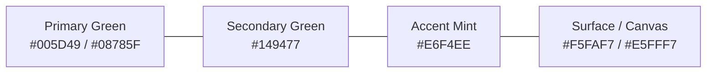

# NETRAVA Design System — Color Palette

**Design System:** Clinical Precision AI  
**Document Version:** 1.0.0  
**Specification File:** `design_reference/design_system/COLORS.md`

---

## 1. Brand & Theme Colors

The NETRAVA palette creates an authoritative, calming, and clinically rigorous visual environment. High-contrast elements are reserved for diagnostic fundus scans, severity levels, and critical actions.



---

## 2. Palette Specification

### 2.1 Primary & Secondary Palette

| Token Name | Hex Code | Flutter / Tailwind Name | Semantic Usage |
|---|---|---|---|
| `primary` | `#005D49` | `AppColors.primaryGreen` | Primary CTAs, active screening navigation, main headers, brand marks. |
| `primary-container` | `#08785F` | `AppColors.primaryContainer` | Container fills for primary elevated buttons, active navigation bars. |
| `on-primary` | `#FFFFFF` | `Colors.white` | Text and icons placed on primary backgrounds. |
| `secondary` | `#149477` | `AppColors.secondaryGreen` | Focused items, interactive toggles, secondary action surfaces. |
| `secondary-container` | `#87F3D2` | `AppColors.secondaryContainer` | Soft bright mint containers, active pill segments. |
| `accent-mint` | `#E6F4EE` | `AppColors.accentMint` | Soft mint background for badges, card highlights, icon container boxes. |
| `light-green-tint` | `#EAF7F1` | `AppColors.lightGreen` | Subtle tint for selected list items and form fields. |

### 2.2 Surface & Canvas Palette

| Token Name | Hex Code | Semantic Usage |
|---|---|---|
| `background` | `#F5FAF7` | Application-wide base canvas; eliminates optical glare under clinical field lighting. |
| `surface` | `#E5FFF7` | Ambient tinted surface container. |
| `surface-container-lowest` | `#FFFFFF` | Pure white for elevated diagnostic cards, modal bottom sheets, form input backgrounds. |
| `surface-container` | `#DAF3EC` | Secondary card fills and nested metadata boxes. |
| `surface-dim` | `#C6DFD8` | De-emphasized surfaces and inactive segment backgrounds. |

### 2.3 Typography & Neutrals

| Token Name | Hex Code | Semantic Usage |
|---|---|---|
| `text-primary` | `#081F1B` | High-contrast dark charcoal/forest text for primary headings and patient names. |
| `text-secondary` | `#3E4944` | Slate gray for body paragraphs, secondary labels, and descriptive text. |
| `text-muted` | `#6E7A74` | Muted slate for metadata timestamps, input placeholders, and tertiary captions. |
| `outline` | `#BDC9C3` | Light borders for cards, dividers, and unselected radio/checkbox boundaries. |
| `divider` | `#D3E2DC` | Subtle horizontal dividers separating list items and sections. |

### 2.4 Clinical Diagnostic Severity Colors (ICDR Scale)

Medical severity indicators follow international ophthalmic triage semantics:

| Grade | Severity Level | Hex Code | Badge Background | Badge Text | Clinical Interpretation |
|---|---|---|---|---|---|
| **0** | **No DR** | `#21A36D` | `#E6F4EE` | `#005D49` | Normal fundus; healthy retina. |
| **1** | **Mild NPDR** | `#E9A23B` | `#FEF6EB` | `#8A5200` | Microaneurysms only; annual follow-up. |
| **2** | **Moderate NPDR** | `#E07A1F` | `#FEF0E0` | `#964200` | Hemorrhages/exudates; 6-month review. |
| **3** | **Severe NPDR** | `#D9534F` | `#FDEEEE` | `#93000A` | 4-2-1 rule met; urgent ophthalmologist referral. |
| **4** | **Proliferative DR** | `#BA1A1A` | `#FFDAD6` | `#5C0003` | Neovascularization; immediate laser/anti-VEGF. |

### 2.5 Diagnostic Heatmap (Grad-CAM) Pseudo-Color Palette

The Grad-CAM overlay utilizes an OpenCV-rendered Jet/Turbo colormap with alpha-blending ($\alpha = 0.40$):
- **Peak Activation (Highest Lesion Focus):** Vivid Red (`#FF0000`) / Crimson (`#CC0000`).
- **Moderate Activation:** Amber Yellow (`#FFCC00`) / Orange (`#FF6600`).
- **Low Activation:** Cyan (`#00CCFF`) / Green (`#00FF66`).
- **Zero Activation (Non-contributing tissue):** Completely transparent (Original fundus visible).

---

## 3. Flutter Color Class Implementation Reference

```dart
// frontend/flutter_app/lib/core/theme/app_colors.dart
import 'package:flutter/material.dart';

class AppColors {
  AppColors._();

  // Brand Palette
  static const Color primaryGreen = Color(0xFF005D49);
  static const Color primaryContainer = Color(0xFF08785F);
  static const Color secondaryGreen = Color(0xFF149477);
  static const Color accentMint = Color(0xFFE6F4EE);
  static const Color lightGreen = Color(0xFFEAF7F1);
  static const Color background = Color(0xFFF5FAF7);
  static const Color cardWhite = Color(0xFFFFFFFF);

  // Text
  static const Color textPrimary = Color(0xFF081F1B);
  static const Color textSecondary = Color(0xFF3E4944);
  static const Color textMuted = Color(0xFF6E7A74);

  // Borders
  static const Color border = Color(0xFFBDC9C3);
  static const Color dividerLine = Color(0xFFD3E2DC);

  // Severity
  static const Color severityNoDR = Color(0xFF21A36D);
  static const Color severityMild = Color(0xFFE9A23B);
  static const Color severityModerate = Color(0xFFE07A1F);
  static const Color severitySevere = Color(0xFFD9534F);
  static const Color severityPDR = Color(0xFFBA1A1A);
}
```

