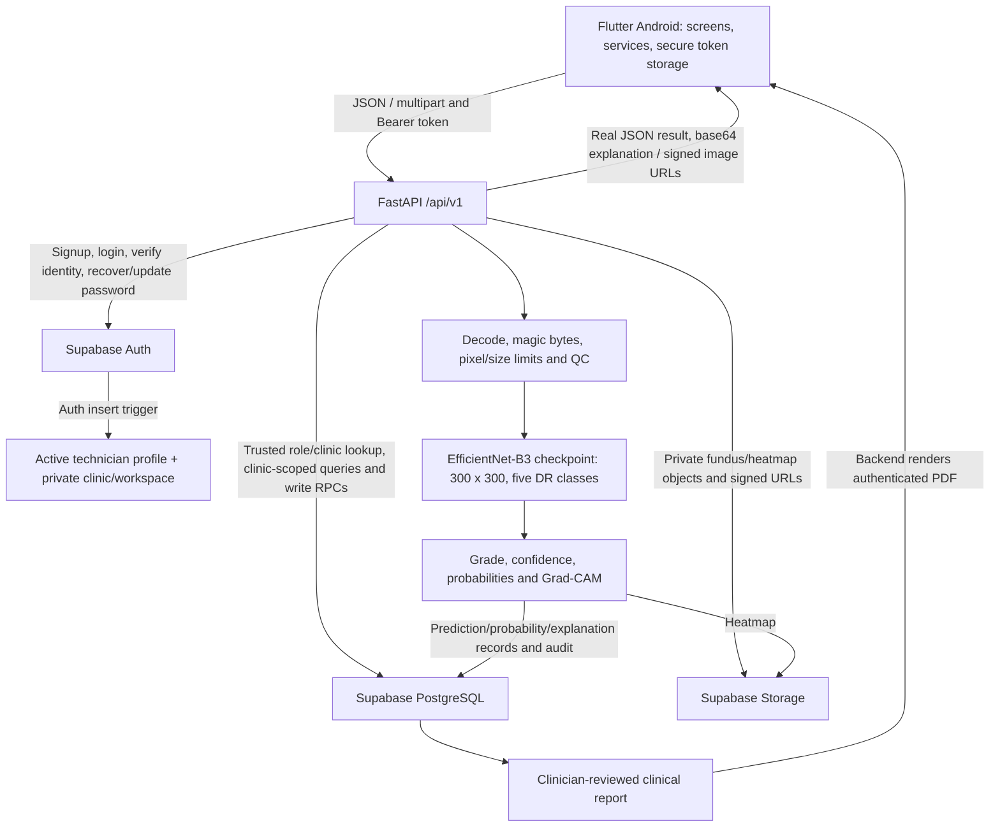

# NETRAVA ? Current project status

> Superseded for Android readiness by [FINAL_ANDROID_READINESS_AUDIT.md](FINAL_ANDROID_READINESS_AUDIT.md), audited 16 November 2026. The separate technician AI PDF is now integrated; fresh hosted Auth settings show mailer_autoconfirm=true. The evidence and acceptance gaps below describe an earlier project state.

Audited 15 November 2026, Asia/Calcutta. This report supersedes older readiness summaries for current implementation/integration status. No application code, model weights or hosted data/settings were changed for this audit.

## Overall conclusion
The Android Flutter client is connected to real FastAPI endpoints for authentication, patient management, screening, QC, inference, explainability and reports. Local automated verification is strong. Core live authentication now works. The complete new-technician signup-to-PDF journey is NOT yet verified and has a real role/workspace dependency at report creation.

**CURRENT PROJECT COMPLETION STATUS: 75%** ? a planning estimate, not a measured code-coverage value or a clinical readiness claim. Transparent rubric: implementation/integration 40/40; local automated validation 25/25; live core signup/login/profile evidence 10/10; complete live workflow/recovery/role-isolation acceptance 0/25. The final 25-point gate is intentionally not credited for partial or historical records. Production release is not implied by this capstone/demo estimate.

## Evidence rules
? Fully Integrated and Tested: wired in active Flutter/FastAPI code, automated tests pass, and the relevant core operation has live evidence (or is a client-only operation exercised by tests).
?? Implemented but Not Fully Tested: wired and locally tested, but complete live Flutter-to-hosted-service acceptance remains unverified or conditional.
? Not Integrated / Not Working: a missing or blocked path in the intended workflow.
Automated Flutter tests use HTTP fixtures. Local actual-SQL workflow uses real PGlite PostgreSQL and EfficientNet-B3, but controlled Auth and Storage adapters. Neither constitutes full live hosted acceptance.

## Feature matrix
| Feature | Status | Evidence and remaining limitation |
|---|---|---|
| User Signup | ? Fully Integrated and Tested | Active form sends name/email/phone/chosen password/confirmation. Live API log 201 and confirmed new Auth identity, active technician profile, saved phone/email and private workspace verified. Duplicate/mismatch/policy tests pass. |
| Login | ? Fully Integrated and Tested | Live POST /auth/login 200 exists in current retained logs; wrong-credential 401s also recorded. Controlled tests assert chosen signup password forwarded and used at login. |
| Logout | ? Fully Integrated and Tested | Client clears secure token, user/session data and temporary PDFs; Flutter tests pass. This is local sign-out, not server/global token revocation. |
| Session/JWT authentication | ? Fully Integrated and Tested | Live /auth/me 200 recorded three times; backend verifies GoTrue identity then trusted active role/workspace. Secure-storage restore and expiry/error paths tested. No automatic refresh tokens. |
| Forgot Password / reset | ?? Implemented but Not Fully Tested | Flutter request screen, backend /recover, recovery-token verification and password update, browser form implemented. Live request 200 observed; inbox delivery, real token consumption and new-password login NOT evidenced. Local reset URL requires opening email on this PC. Hosted URL/template configuration not verified. |
| Patient Registration | ?? Implemented but Not Fully Tested | Flutter form -> POST /patients -> register_clinic_patient RPC. Fixture, API and actual SQL checks pass. Three hosted patients exist historically, but new-user workspace has zero and no live POST success in retained logs. |
| Patient List/Search | ?? Implemented but Not Fully Tested | Flutter pagination/search -> GET /patients; live GET 200 logged. Live search, pagination, create-then-list and cross-workspace acceptance not completed. |
| Retinal Image Upload | ?? Implemented but Not Fully Tested | Image picker/camera, JPEG/PNG/size checks, multipart /screenings; backend validation and private storage. Local tests pass. No retained live new-user upload success; actual camera/gallery and hosted upload roundtrip pending. |
| Image Quality Check | ?? Implemented but Not Fully Tested | Real backend blur/illumination/gradability checks, Flutter pass/reject UI. Local real-image and rejection tests pass; live device image acceptance/rejection pending. |
| AI/Deep Learning Prediction | ?? Implemented but Not Fully Tested | /predict calls actual EfficientNet-B3 checkpoint; identical original image bytes verified against persisted SHA-256. Real-checkpoint local/API checks pass. No full live Flutter + hosted Storage/persistence run evidenced. |
| DR Grade Prediction | ?? Implemented but Not Fully Tested | 0?4 grade/class response rendered in Flutter; real checkpoint tests pass. Live new-screening display not verified. |
| Confidence Score | ?? Implemented but Not Fully Tested | Real softmax confidence and five probabilities, rendered as percentages/bars. Normalization/output tests pass. Live new-screening display pending. |
| Grad-CAM / Explainability | ?? Implemented but Not Fully Tested | Actual conv_head Grad-CAM; upload/persist explanation, base64/signed URL response and Flutter rendering. Nonzero-gradient/local pipeline checks pass. Hosted heatmap roundtrip/display pending. |
| Saving Screening Results | ?? Implemented but Not Fully Tested | Screening/image and prediction/probability/explanation RPCs and audit entries. Actual SQL tests pass. Hosted historical rows exist, but new user's workspace has zero screenings; full fresh-user persistence/reload pending. |
| Report/PDF Generation | ?? Implemented but Not Fully Tested | Role-gated report draft/sign-off, get-report and PDF from persisted data; Flutter download/open. Real SQL/API/PDF and fixture tests pass. New private technician workspace cannot create its own clinical report; see blocker below. Live device PDF open pending. |

No active screening feature above is backed by dummy production responses. Fixtures are isolated under tests. Older welcome/login prototypes remain outside active SessionGate navigation; they contain placeholder OAuth UI and must not be mistaken for active features.

## Current architecture

Core Flutter/FastAPI/Auth connections have live success evidence. Backend-to-hosted database is reachable; real tables and RPC names are exposed. Medical buckets exist and are private. Real AI is locally loaded and executed. End-to-end clinical data/Storage write integration is locally verified with adapters, not yet accepted against all hosted services together.

PDF is currently rendered on demand from a saved clinical report and returned as bytes; a clinical-reports bucket exists but that does not prove PDFs are uploaded there. The PDF currently contains clinical fields/probabilities and does not embed the Grad-CAM image.

## Exact new-user workflow verification
| Step | Actually tested? | Current result |
|---|---|---|
| New user signup | Yes: live 201 + owner success + fresh hosted identity/profile | ? |
| Email confirmation | Yes: hosted account currently confirmed; email-link UI not independently replayed | ? current account state |
| Login | Yes: live API log 200; fixtures also pass | ? |
| Dashboard | Automated widget workflow passes; manual post-login dashboard acceptance not captured separately | ?? |
| Register patient | Actual local SQL/API + Flutter fixture tested; not new hosted workspace | ?? |
| Select/list/search patient | Live listing 200 + fixture navigation; fresh patient search/selection not manually confirmed | ?? |
| Select OD/OS and upload fundus image | Local API + Flutter fixture tested; not fresh hosted device workflow | ?? |
| Quality check | Actual local image QC tested; live acceptance/rejection pending | ?? |
| AI prediction | Actual checkpoint executed locally; live persisted device run pending | ?? |
| DR grade | Actual local output + fixture rendering tested | ?? |
| Confidence/five probabilities | Actual local normalization/output + fixture rendering tested | ?? |
| Grad-CAM | Actual local gradient/image generation + fixture rendering tested | ?? |
| Save result | Real local SQL persistence verified; fresh hosted screening still absent | ?? |
| Create clinical report as new technician | Forbidden by design; its workspace has no clinician/admin | ? blocked path |
| Generate/view PDF as that user | Requires saved clinical report; no report can currently be created by that user alone | ? blocked path; general PDF implementation exists |

Important: automatic prediction persistence is implemented; a separate manual Save Result button is not required. Historical hosted counts do not establish this fresh-user workflow.

## Hosted read-only observations at audit time
- Backend GET /api/v1/health: 200, healthy, development, CPU, model_loaded=true, database_connected=true.
- Three Auth identities observed. The newly recreated test email is confirmed, active technician, phone/email saved, with a private workspace.
- New workspace: one member (technician), zero patients, zero screenings, zero audit events. No clinician/admin member.
- Project-wide historical counts: patients 3; screenings 2; retinal_images 2; predictions 2; prediction_probabilities 10; explanations 2; reports 1; audit_logs 8.
- fundus-images, gradcam-heatmaps and clinical-reports buckets: public=false.
- Expected RPC names exposed: register_clinic_patient, create_screening_records, write_screening_prediction, write_screening_review, netrava_require_staff, netrava_current_clinic, netrava_report_json. Other legacy helpers remain exposed in metadata. REST metadata does not prove function bodies, SQL grants or RLS deployment correctness.
- Email/password signup enabled; email confirmation required. Recovery URL configured locally as http://127.0.0.1:8000/api/v1/auth/reset-password. Public HTTPS deployment absent. Hosted recovery template/redirect allowlist/SMTP configuration not verified by this audit.
- Retained local server logs: signup 201 (1), login 200 (1), /auth/me 200 (3), GET /patients 200 (3), forgot-password request 200 (1). Counts are evidence from retained files, not a complete historical event ledger. A recovery 200 means request accepted, not that email was delivered or password reset succeeded.

## Fresh verification performed
1. `.\.venv\Scripts\python.exe -m pytest backend/tests ai_model/tests -q -p no:cacheprovider --basetemp=.pytest-status-20261115`: **158 passed**, six dependency/config warnings.
2. `flutter test --no-pub` from frontend/flutter_app: **11 passed** (fixtures, not all-live).
3. Dart analysis of frontend/flutter_app/lib: **No issues found**.
4. `.\.venv\Scripts\python.exe scripts/database_test/verify_api_workflow.py`: **16 API checks + 50 SQL checks passed**, actual_model=true, actual_sql=true, live_auth=false, live_storage=false.
5. `node scripts/database_test/verify_active_signup.mjs`: active profile/private workspace, RLS, role protection, patient creation, cross-clinic denial and atomic rollback checks passed.
6. `node scripts/database_test/verify_signup.mjs`: historical pending-signup migration checks passed in isolation. This test validates the old migration stage; it is NOT the intended final active-signup behavior.
7. Hosted health/Auth/profile/count/bucket/schema checks: read-only, no account creation, email send, patient writes, Storage writes or migrations.
8. Android debug APK was built/installed successfully in the preceding password-policy fix. It was not rebuilt in this audit. The emulator integration_test is a health/login-validation smoke test, not a complete authenticated clinical E2E test; no claim of a fresh device smoke run here.
No current coverage percentage was measured. Historical 85% coverage must not be presented as a fresh result.

## Critical before project completion (priority order)
1. Resolve the private-workspace clinical report handoff. Choose an authorized same-workspace reviewer/invitation workflow, or a separately labelled preliminary AI screening PDF for technicians while retaining clinician-only clinical review/sign-off. Do not make new users administrators or remove clinic isolation. Current ReportScreen download requires an existing report, and backend get_report_pdf calls get_report first.
2. Complete one recorded live new-user run: login -> register synthetic test patient -> list/search/select -> OD/OS -> actual retinal upload -> QC -> prediction -> displayed grade/confidence/probabilities/Grad-CAM -> persistence verification -> authorized report/PDF. Keep clearly labelled test data; check saved results after app restart.
3. Finish real Forgot Password acceptance: verify allowlisted reset URL, reviewed recovery email template using RedirectTo + fragment token_hash, working SMTP/provider delivery, mailbox link, chosen password update, old password rejection and new-password login. Local link must be opened on the PC hosting the backend.
4. Verify hosted RLS/function grants/Storage access with real role tokens. Service-role read access and bucket private flags alone do not establish per-user isolation. Verify second workspace cannot access the first's patient/image/report; verify anonymous denial and technician review denial.
5. Reconcile authoritative documentation with current frontend/auth implementation. This report is current; old readiness sections remain historical. Do not rerun old pending-signup migration after the active-signup migration.

## Testing required
- Live new account's chosen password -> login; existing duplicate email must not mutate password; invalid email, short (<12) password, confirmation mismatch, wrong password, disabled account/clinic, missing/invalid/expired token.
- Native secure-session restore after restart and local logout; expired sessions require login because refresh-token handling is absent.
- Patient form limits, duplicate MRN, search/pagination, empty lists, real create/select, two-workspace authorization.
- Actual Android gallery/camera permissions, valid OD/OS images, bad magic bytes, oversized/corrupt/poor-quality inputs, timeout/retry behavior.
- Actual five-class output/probability sum, saved prediction and explanation linkage, signed URL availability/expiry, no repeated inference on result navigation.
- Same-workspace reviewer creates draft/signs; technician cannot review; signed report immutable; correct PDF patient/grade/probabilities; PDF opens on emulator/device and temporary files clear on logout.
- Recovery valid/expired/reused link and delivery; no sensitive values in responses/logs.

## Optional improvements / deployment scope
- Persisted screening/prediction history, patient-specific screening list and clinician queue. Current recent-screening IDs exist only in memory; report lookup otherwise needs screening UUID.
- Token refresh/rotation, signed-URL renewal and global logout if needed.
- Profile/patient edit workflows, account-management UI, workspace invitations, password-change UI; no requirement to expose privileged role selection publicly.
- PDF Grad-CAM embedding, language/accessibility refinement and measured on-device usability/performance.
- Replace linear Auth-user scan for duplicate signup before larger deployments.
- Deployment: public HTTPS backend, correct release API_BASE_URL, production secrets validation, Android production signing (currently debug signing even for release), operational logging/backups/rate limits and monitored uptime.
- iOS/web/desktop acceptance is unverified; current native PDF implementation uses dart:io. Clinical model validation/calibration and a safety review are separate from passing software tests.

## Exact next actions
1. Owner/developer selects the safe report path described above. Do not change roles or hosted schema as part of this audit.
2. Run the live new-technician patient/upload/prediction path using a real retinal test image and verify rows/objects for that workspace.
3. Configure/review recovery delivery and complete a real reset with the owner's inbox.
4. Add/verify reviewer access or a preliminary PDF path; complete report download/open.
5. Run hosted two-user isolation and native restart/logout tests, record evidence and update this report. Only then claim the complete E2E project works.

## Source map
Frontend: lib/app/app.dart; screens/auth/session_gate.dart, sign_in_screen.dart, sign_up_screen.dart, forgot_password_screen.dart; providers/session.dart; services/*; screens/patients/*, screening/screening_screen.dart, results/result_screen.dart, reports/report_screen.dart; models/user.dart.
Backend: app/api/v1/auth.py, patients.py, screening.py, predict.py; core/security.py, config.py; services/auth_service.py, password_recovery.py, patient_service.py, screening_service.py, prediction_service.py, report_service.py, report_pdf.py; ml/model_bridge.py, image_validator.py; ai_model inference package.
Database: supabase/migrations/202611130001_normalized_backend.sql and 202611140002_active_signup.sql (202611140001 is historical intermediate stage).
Tests: backend/tests; ai_model/tests; frontend/flutter_app/test; integration_test/emulator_smoke_test.dart; scripts/database_test/verify_api_workflow.py and SQL verification scripts.
