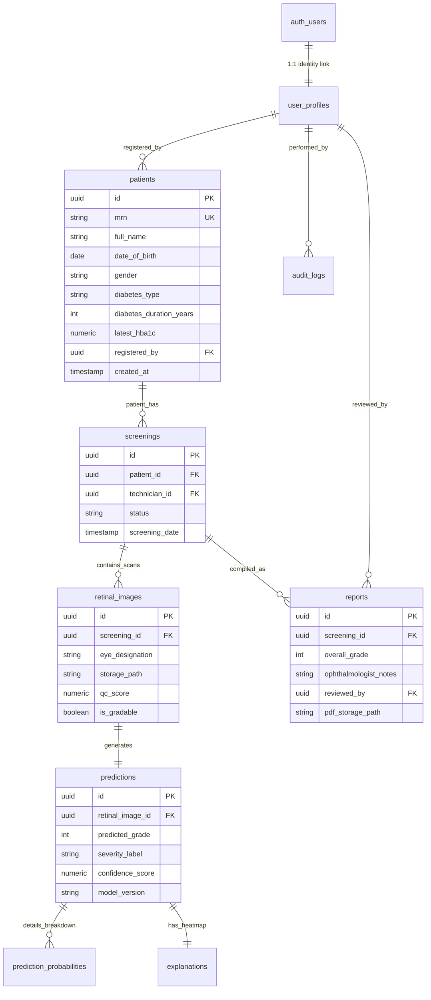

# NETRAVA — Supabase Database Architecture & DDL Specification

**Database Engine:** PostgreSQL 15+ (Supabase Managed Cloud)  
**Document Version:** 1.0.0  
**Authority:** Agent 05 (Database Engineer)

## Implementation status (2026-11-03)

The executable local schema is `supabase/migrations/202611030001_backend_core.sql`. It currently defines `clinics`, `user_profiles`, `patients`, `screenings`, `retinal_images`, `predictions`, `reports`, and `audit_logs`. The five probabilities are stored as a JSONB array on `predictions`; the Grad-CAM object key is stored in `predictions.gradcam_heatmap_path`. There are no separate `prediction_probabilities` or `explanations` tables in this migration.

The migration includes clinic-bound RLS, backend-only transactional write RPCs, append-only audit records, and private storage buckets. It has not been applied to PostgreSQL or verified against a live Supabase project. The ER diagram and design sections below remain the broader target model and may include entities not yet represented in the current migration.

---

## 1. Relational Entity Relationship Diagram



---

## 2. Table Specifications & DDL Blueprints

### 2.1 Table: `user_profiles`
Links to `auth.users` managed by Supabase GoTrue.
```sql
CREATE TYPE user_role AS ENUM ('technician', 'ophthalmologist', 'administrator');

CREATE TABLE public.user_profiles (
    id UUID PRIMARY KEY REFERENCES auth.users(id) ON DELETE CASCADE,
    full_name TEXT NOT NULL,
    role user_role NOT NULL DEFAULT 'technician',
    clinic_name TEXT NOT NULL,
    license_number TEXT,
    phone_number TEXT,
    is_active BOOLEAN NOT NULL DEFAULT true,
    created_at TIMESTAMPTZ NOT NULL DEFAULT now(),
    updated_at TIMESTAMPTZ NOT NULL DEFAULT now()
);

CREATE INDEX idx_user_profiles_role ON public.user_profiles(role);
CREATE INDEX idx_user_profiles_clinic ON public.user_profiles(clinic_name);
```

### 2.2 Table: `patients`
Stores demographic and diabetic medical background.
```sql
CREATE TYPE diabetes_type_enum AS ENUM ('type_1', 'type_2', 'gestational', 'pre_diabetes', 'unknown');

CREATE TABLE public.patients (
    id UUID PRIMARY KEY DEFAULT gen_random_uuid(),
    mrn TEXT UNIQUE NOT NULL, -- Medical Record Number
    full_name TEXT NOT NULL,
    date_of_birth DATE NOT NULL,
    gender TEXT NOT NULL CHECK (gender IN ('male', 'female', 'other')),
    phone_number TEXT,
    diabetes_type diabetes_type_enum NOT NULL DEFAULT 'type_2',
    diabetes_duration_years INT CHECK (diabetes_duration_years >= 0),
    latest_hba1c NUMERIC(4,2) CHECK (latest_hba1c >= 3.0 AND latest_hba1c <= 20.0),
    is_insulin_dependent BOOLEAN DEFAULT false,
    registered_by UUID NOT NULL REFERENCES public.user_profiles(id),
    clinic_name TEXT NOT NULL,
    created_at TIMESTAMPTZ NOT NULL DEFAULT now(),
    updated_at TIMESTAMPTZ NOT NULL DEFAULT now()
);

CREATE INDEX idx_patients_mrn ON public.patients(mrn);
CREATE INDEX idx_patients_clinic ON public.patients(clinic_name);
CREATE INDEX idx_patients_name ON public.patients USING gin (to_tsvector('english', full_name));
```

### 2.3 Table: `screenings`
Represents an individual point-of-care screening encounter.
```sql
CREATE TYPE screening_status_enum AS ENUM ('pending_capture', 'processing_ai', 'completed', 'referred', 'reviewed');

CREATE TABLE public.screenings (
    id UUID PRIMARY KEY DEFAULT gen_random_uuid(),
    patient_id UUID NOT NULL REFERENCES public.patients(id) ON DELETE CASCADE,
    technician_id UUID NOT NULL REFERENCES public.user_profiles(id),
    status screening_status_enum NOT NULL DEFAULT 'processing_ai',
    notes TEXT,
    created_at TIMESTAMPTZ NOT NULL DEFAULT now(),
    updated_at TIMESTAMPTZ NOT NULL DEFAULT now()
);

CREATE INDEX idx_screenings_patient ON public.screenings(patient_id);
CREATE INDEX idx_screenings_status ON public.screenings(status);
CREATE INDEX idx_screenings_created ON public.screenings(created_at DESC);
```

### 2.4 Table: `retinal_images`
Records fundus captures and quality control assessments.
```sql
CREATE TYPE eye_designation_enum AS ENUM ('OD', 'OS'); -- OD = Right Eye, OS = Left Eye

CREATE TABLE public.retinal_images (
    id UUID PRIMARY KEY DEFAULT gen_random_uuid(),
    screening_id UUID NOT NULL REFERENCES public.screenings(id) ON DELETE CASCADE,
    eye eye_designation_enum NOT NULL,
    storage_path TEXT NOT NULL, -- Path in private 'fundus-images' bucket
    file_size_bytes BIGINT NOT NULL,
    mime_type TEXT NOT NULL DEFAULT 'image/jpeg',
    width INT NOT NULL,
    height INT NOT NULL,
    qc_blur_score NUMERIC(6,2),
    qc_passed BOOLEAN NOT NULL DEFAULT true,
    captured_at TIMESTAMPTZ NOT NULL DEFAULT now()
);

CREATE INDEX idx_retinal_images_screening ON public.retinal_images(screening_id);
```

### 2.5 Table: `predictions`
Stores EfficientNet-B3 severity classifications.
```sql
CREATE TABLE public.predictions (
    id UUID PRIMARY KEY DEFAULT gen_random_uuid(),
    retinal_image_id UUID UNIQUE NOT NULL REFERENCES public.retinal_images(id) ON DELETE CASCADE,
    predicted_grade INT NOT NULL CHECK (predicted_grade BETWEEN 0 AND 4),
    severity_label TEXT NOT NULL, -- 'No DR', 'Mild', 'Moderate', 'Severe', 'Proliferative DR'
    confidence_score NUMERIC(5,4) NOT NULL CHECK (confidence_score BETWEEN 0.0 AND 1.0),
    raw_logits JSONB NOT NULL, -- Array of 5 floating-point logits
    model_version TEXT NOT NULL DEFAULT 'efficientnet_b3_staged_v1',
    inference_time_ms NUMERIC(6,2) NOT NULL,
    created_at TIMESTAMPTZ NOT NULL DEFAULT now()
);

CREATE INDEX idx_predictions_grade ON public.predictions(predicted_grade);
CREATE INDEX idx_predictions_image ON public.predictions(retinal_image_id);
```

### 2.6 Table: `prediction_probabilities`
Class-by-class probability vectors.
```sql
CREATE TABLE public.prediction_probabilities (
    id UUID PRIMARY KEY DEFAULT gen_random_uuid(),
    prediction_id UUID NOT NULL REFERENCES public.predictions(id) ON DELETE CASCADE,
    grade INT NOT NULL CHECK (grade BETWEEN 0 AND 4),
    class_name TEXT NOT NULL,
    probability NUMERIC(6,5) NOT NULL CHECK (probability BETWEEN 0.0 AND 1.0)
);

CREATE INDEX idx_probabilities_prediction ON public.prediction_probabilities(prediction_id);
```

### 2.7 Table: `explanations`
Grad-CAM spatial activation map metadata.
```sql
CREATE TABLE public.explanations (
    id UUID PRIMARY KEY DEFAULT gen_random_uuid(),
    prediction_id UUID UNIQUE NOT NULL REFERENCES public.predictions(id) ON DELETE CASCADE,
    heatmap_storage_path TEXT NOT NULL, -- Path in private 'gradcam-heatmaps' bucket
    target_layer TEXT NOT NULL DEFAULT 'conv_head',
    peak_activation NUMERIC(6,4),
    created_at TIMESTAMPTZ NOT NULL DEFAULT now()
);

CREATE INDEX idx_explanations_prediction ON public.explanations(prediction_id);
```

### 2.8 Table: `reports`
Official clinical reports and ophthalmologist review records.
```sql
CREATE TABLE public.reports (
    id UUID PRIMARY KEY DEFAULT gen_random_uuid(),
    screening_id UUID UNIQUE NOT NULL REFERENCES public.screenings(id) ON DELETE CASCADE,
    overall_grade INT NOT NULL CHECK (overall_grade BETWEEN 0 AND 4),
    is_urgent_referral BOOLEAN NOT NULL DEFAULT false,
    clinical_recommendation TEXT NOT NULL,
    ophthalmologist_id UUID REFERENCES public.user_profiles(id),
    ophthalmologist_notes TEXT,
    grade_override INT CHECK (grade_override BETWEEN 0 AND 4),
    is_signed_off BOOLEAN NOT NULL DEFAULT false,
    signed_off_at TIMESTAMPTZ,
    pdf_storage_path TEXT, -- Path in 'clinical-reports' bucket
    created_at TIMESTAMPTZ NOT NULL DEFAULT now(),
    updated_at TIMESTAMPTZ NOT NULL DEFAULT now()
);

CREATE INDEX idx_reports_screening ON public.reports(screening_id);
CREATE INDEX idx_reports_urgent ON public.reports(is_urgent_referral);
```

### 2.9 Table: `audit_logs`
Tamper-evident clinical compliance log.
```sql
CREATE TABLE public.audit_logs (
    id UUID PRIMARY KEY DEFAULT gen_random_uuid(),
    user_id UUID REFERENCES public.user_profiles(id),
    action TEXT NOT NULL, -- e.g., 'INFERENCE_GENERATED', 'GRADE_OVERRIDDEN', 'REPORT_SIGNED'
    entity_type TEXT NOT NULL, -- 'screening', 'patient', 'report'
    entity_id UUID NOT NULL,
    previous_state JSONB,
    new_state JSONB,
    ip_address INET,
    user_agent TEXT,
    created_at TIMESTAMPTZ NOT NULL DEFAULT now()
);

CREATE INDEX idx_audit_logs_user ON public.audit_logs(user_id);
CREATE INDEX idx_audit_logs_entity ON public.audit_logs(entity_type, entity_id);
CREATE INDEX idx_audit_logs_created ON public.audit_logs(created_at DESC);
```

---

## 3. Row Level Security (RLS) Policies

All tables have RLS enabled:
```sql
ALTER TABLE public.user_profiles ENABLE ROW LEVEL SECURITY;
ALTER TABLE public.patients ENABLE ROW LEVEL SECURITY;
ALTER TABLE public.screenings ENABLE ROW LEVEL SECURITY;
ALTER TABLE public.retinal_images ENABLE ROW LEVEL SECURITY;
ALTER TABLE public.predictions ENABLE ROW LEVEL SECURITY;
ALTER TABLE public.explanations ENABLE ROW LEVEL SECURITY;
ALTER TABLE public.reports ENABLE ROW LEVEL SECURITY;
ALTER TABLE public.audit_logs ENABLE ROW LEVEL SECURITY;
```

### Core Policy Rules:
1. **Technicians:**
   - Can select, insert, and update `patients` registered in their `clinic_name`.
   - Can select and insert `screenings` and `retinal_images` where `technician_id = auth.uid()`.
   - Cannot update `reports.is_signed_off` or override diagnostic grades.
2. **Ophthalmologists:**
   - Can select all patients and screenings within their assigned health network.
   - Can update `reports` to add clinical notes, grade overrides, and digital signatures.
3. **Administrators:**
   - Full read/write access across all user profiles, clinic settings, and audit logs.
4. **Anonymous / Public Users:**
   - Denied all read and write permissions (`RESTRICT ALL`).

---

## 4. Storage Bucket Configuration

| Bucket Name | Access Level | Allowed MIME Types | File Size Limit |
|---|---|---|---|
| `fundus-images` | Private (Signed URLs Only) | `image/jpeg`, `image/png` | 15 MB |
| `gradcam-heatmaps` | Private (Signed URLs Only) | `image/jpeg`, `image/png` | 10 MB |
| `clinical-reports` | Private (Signed URLs Only) | `application/pdf` | 10 MB |

