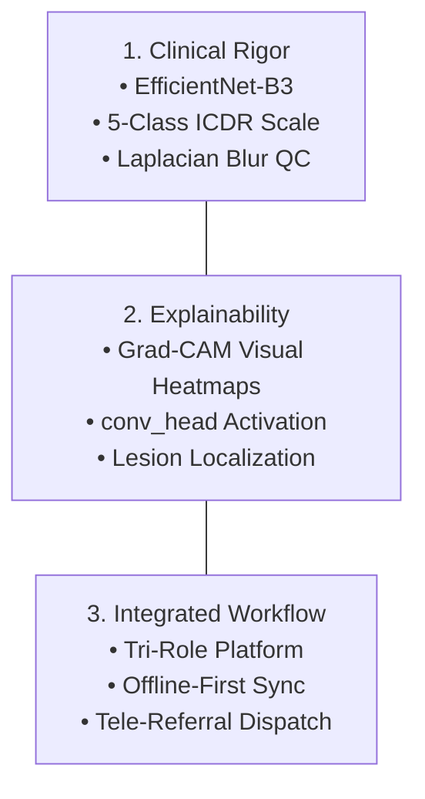

# NETRAVA — Project Overview

**Document Version:** 1.0.0  
**Authority:** Senior Software Architect & Lead Multi-Agent Coordinator  
**System Title:** Explainable AI-Based Diabetic Retinopathy Screening System  
**Tagline:** See. Detect. Explain.

---

## 1. Vision & Clinical Mission

Diabetic Retinopathy (DR) is the primary cause of blindness in adults aged 20–74. An estimated 100+ million people globally live with DR. However, over 90% of severe vision loss is preventable through timely detection and clinical intervention.

In low- and middle-income countries, and rural healthcare regions, patients face a severe shortage of ophthalmologists:
- Patient-to-ophthalmologist ratios often exceed 200,000 : 1.
- Many diabetic individuals live hundreds of kilometers from retinal specialists.
- Most primary health workers lack the specialized training to recognize early microaneurysms or retinal hemorrhages with standard ophthalmoscopes.

**NETRAVA** is engineered to transform standard smartphones paired with portable fundus camera attachments into autonomous, point-of-care screening stations. By coupling rapid neural network inference with transparent Grad-CAM explainability, NETRAVA empowers field health workers to screen patients in primary clinics and instantly triage urgent cases to hospital specialists.

---

## 2. Core Pillars of the System

### Pillar 1: Clinical Rigor & Reliability
- Trained on diverse retinal fundus imagery using square-root inverse-frequency loss weighting to counteract class imbalance.
- Real-time image quality assessment eliminates blurry or underexposed scans before model prediction.

### Pillar 2: Explainable AI (XAI)
- Eliminates the "black-box" dilemma by producing heatmaps localized to specific retinal microvascular pathologies.
- Fosters clinical trust and provides visual justification for referral decisions.

### Pillar 3: Handheld Field Ergonomics
- Designed specifically for field health workers managing high-throughput screening camps.
- Offline resilience guarantees that patient intake and imaging continue uninterrupted regardless of internet connectivity.

---

## 3. The 3 Primary User Roles

### Role 1: Field Technician
- Primary device: Android/iOS smartphone running the NETRAVA mobile client.
- Responsibilities:
  - Patient intake and demographic registration.
  - Optical alignment and fundus camera capture.
  - Verification of image quality control (QC).
  - Reviewing preliminary AI grading and generating printed screening slips.

### Role 2: Ophthalmologist / Retinal Specialist
- Primary device: Tablet, workstation web dashboard, or mobile client.
- Responsibilities:
  - Reviewing screening queues flagged as Moderate, Severe, or Proliferative DR.
  - Inspecting dual fundus scans and Grad-CAM lesion heatmaps.
  - Validating, adjusting, or overriding AI predictions.
  - Digitally signing clinical reports and managing tele-consultations.

### Role 3: Clinic Administrator
- Primary device: Administrative desktop console.
- Responsibilities:
  - Provisioning and managing technician and clinician user accounts.
  - Monitoring clinic throughput, screening volume, and device health.
  - Reviewing immutable security and clinical audit logs.

