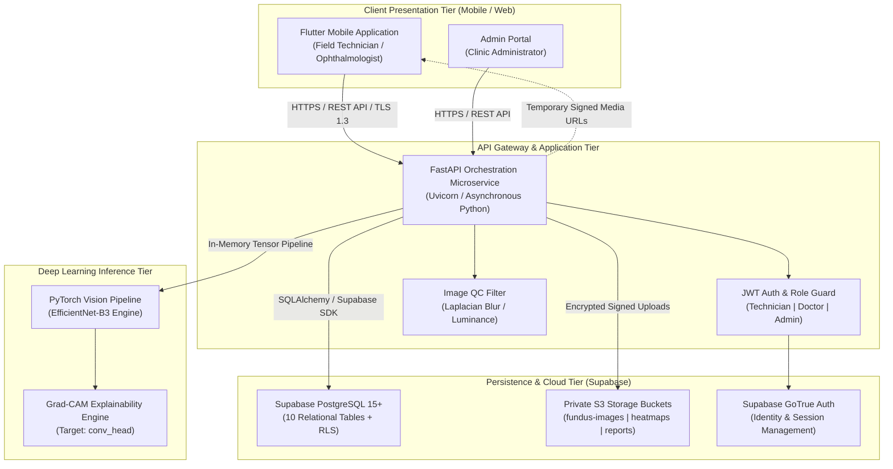
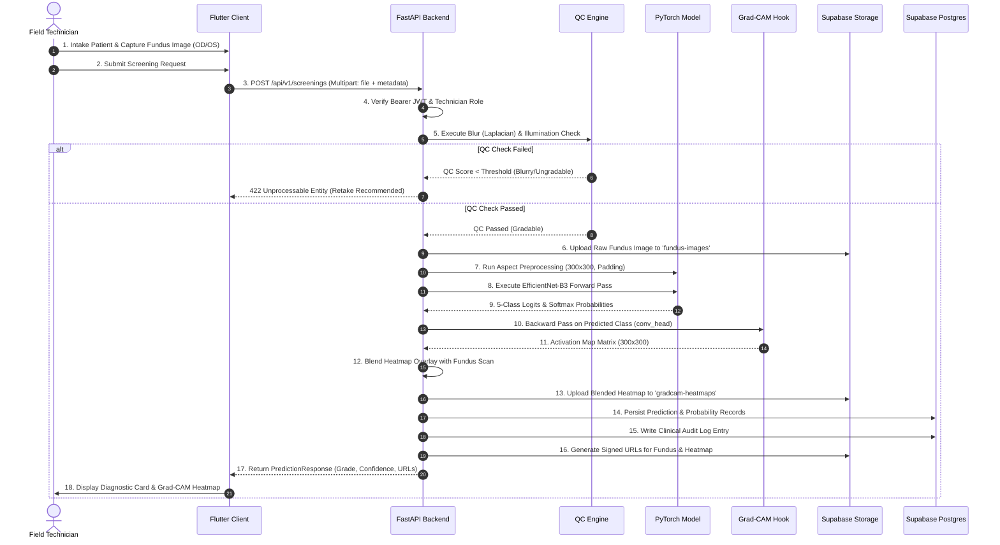

# NETRAVA — End-to-End System Architecture

**Document Version:** 1.0.0  
**Authority:** Senior Software Architect & Lead Multi-Agent Coordinator  
**System Title:** Explainable AI-Based Diabetic Retinopathy Screening System

---

## 1. High-Level Distributed Architecture

NETRAVA is organized as a decoupled, four-tier microservices architecture engineered for high availability, sub-second inference latency, and strict healthcare compliance:

---

## 2. Architectural Tiers Breakdown

### 2.1 Client Presentation Tier
- **Technology:** Flutter 3.x with Dart ^3.12.
- **Responsibilities:**
  - Hardware camera management and optical reticle HUD display.
  - Client-side validation of patient intake demographics and vitals.
  - Interactive dual-layer image viewing (Original Fundus + Grad-CAM Heatmap overlay).
  - Offline local caching (SQLite) with background request queueing.

### 2.2 Gateway & Application Tier
- **Technology:** FastAPI running on Uvicorn with Pydantic V2.
- **Responsibilities:**
  - Ingress request validation and schema enforcement.
  - Role-Based Access Control (RBAC) verification.
  - Quality Control (QC) scoring before triggering GPU inference.
  - Image base64 / binary multipart decoding and storage orchestration.
  - Report compilation and PDF document generation.

### 2.3 Deep Learning Inference Tier
- **Technology:** PyTorch 2.2+, timm 0.9+, OpenCV, Pillow.
- **Responsibilities:**
  - Aspect-ratio-preserving $300 \times 300$ image preprocessing (`ResizeWithPadding`).
  - Thread-safe forward pass through fine-tuned EfficientNet-B3.
  - Softmax probability computation and top-1 ICDR severity classification.
  - Forward/backward hook extraction on `model.conv_head` to generate Grad-CAM heatmaps.
  - Alpha-blending pseudo-colored heatmaps (Jet colormap) with preprocessed fundus images.

### 2.4 Persistence & Cloud Tier
- **Technology:** Supabase (PostgreSQL 15+, GoTrue, S3 Storage).
- **Responsibilities:**
  - 10-table normalized relational schema.
  - Strict Row Level Security (RLS) enforcement on all patient records.
  - Zero public S3 bucket exposure; time-limited signed URL generation.
  - Immutable audit logging for clinical accountability.

---

## 3. End-to-End Screening Data Flow

---

## 4. Availability, Resilience & Scalability

- **Stateless Application Servers:** The FastAPI backend is fully stateless. Worker processes can be scaled horizontally behind a round-robin load balancer.
- **Asynchronous Execution:** Heavy disk I/O and S3 uploads are handled asynchronously to prevent blocking the event loop.
- **GPU / CPU Portability:** The PyTorch loader automatically selects `cuda` if available, falling back gracefully to optimized multi-threaded `cpu` execution.

